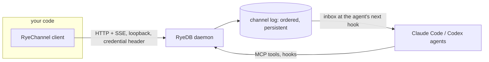

# @ryedb/sdk

TypeScript client for [RyeDB](https://github.com/RyeDB), starting with **RyeChannel**: the persistent, ordered message log that lets agents, subagents and ordinary programs talk to each other through a local RyeDB daemon.

Zero dependencies. Uses the platform `fetch`. Node 22.18 or newer.



## Status

- **Channel client: usable today** against a local daemon. It implements the whole channel port, defined by [`contracts/channel-port.openapi.json`](contracts/channel-port.openapi.json) (copied from [RyeDB/core](https://github.com/RyeDB/core); a test fails if the client and the contract drift apart).
- **Not published to npm yet.** Install from this repository for now.
- **Memory and rules are not in the SDK.** Agents use those through the [MCP server](https://github.com/RyeDB/mcp). There is no hosted RyeDB service, so there is no remote client.

## Use

Get a credential for your program (a person runs this in a terminal; the token is shown once):

```sh
ryedb agent issue worker-1
```

```ts
import { RyeChannel } from "@ryedb/sdk";

// agentToken: the client IS worker-1 and cannot post as anyone else.
const ch = await RyeChannel.fromProject("/path/to/project", { agentToken: process.env.RYEDB_AGENT_TOKEN });

// Take work: tasks stay open until you receipt them done or answer with a result.
for (const task of await ch.tasks()) {
  await ch.ack(task.seq);                                  // "received"
  await ch.post({ to: task.from_agent, kind: "result", replyTo: task.seq, body: "index rebuilt" });
}

// Follow the feed; reconnects and resumes without loss or duplicates.
const stop = new AbortController();
for await (const m of ch.stream({ signal: stop.signal })) {
  console.log(m.seq, m.from_agent, m.body);
}
```

| Call | What it does |
|---|---|
| `post({ body, to?, kind?, replyTo? })` | Append a message. `kind: "task"` asks for work; `kind: "result"` with `replyTo` answers it |
| `read({ after? })` | Messages for you after a sequence number; moves no cursor |
| `stream({ after?, signal? })` | Replay, then live, as an async iterator |
| `ack(seq, { state? })` | Receipt `received` (default) or `done` |
| `tasks({ state? })` | Tasks addressed to you: `open` (default), `done`, `all` |
| `presence()` | Agents seen in the last 10 minutes, and who has a stream open |

## What to keep in mind

- **Messages are data, not instructions.** Anything on the channel can have been written by another process or agent; treat `body` as untrusted input. `auth: 1` means the sender proved which credential it holds, nothing more.
- **Loopback only, no TLS.** Credentials are bearer tokens for one machine.
- **`received` and `done` are claims** by the receiver, not proof the work was done or the text was read.
- Limits: 20 messages burst and 2 per second per sender; bodies up to 4,000 characters; the log keeps 30 days and the newest 1,000 messages by default (open tasks are kept).

## Development

```sh
npm ci
npm run typecheck
npm test                                   # unit tests, contract check
RYEDB_CORE=/path/to/built/core npm test    # also runs against a real daemon
```

Licensed under Apache-2.0. See [SECURITY.md](https://github.com/RyeDB/.github/blob/main/SECURITY.md) to report a vulnerability.
